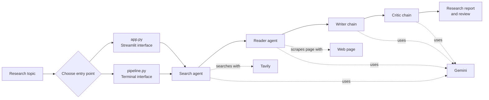

# ResearchMind

ResearchMind is a small AI research system. Give it a topic and it gathers web information, reads a relevant page, writes a report, and reviews that report.

## The flow

## What each step does

1. **Search agent** asks Tavily for recent web results about the topic.
2. **Reader agent** chooses a relevant result and uses the scraper to extract page text.
3. **Writer chain** combines the search results and page text into a structured report.
4. **Critic chain** reviews the report and returns a score, strengths, improvements, and a verdict.

The search and reader are LangChain agents because they can use tools. The writer and critic are prompt chains: they use Gemini to generate text, but do not call tools.

## Main files

| File | Role |
|---|---|
| `app.py` | Streamlit interface; runs the steps and shows the report, review, and raw research. |
| `pipeline.py` | Terminal entry point; runs the research flow and returns its results in a dictionary. |
| `agents.py` | Configures the Gemini model, search/reader agents, and writer/critic chains. |
| `tools.py` | Implements Tavily web search and web-page text scraping. |

## In one sentence

`app.py` or `pipeline.py` coordinates the workflow; `agents.py` defines the AI roles; `tools.py` connects the agents to web information.